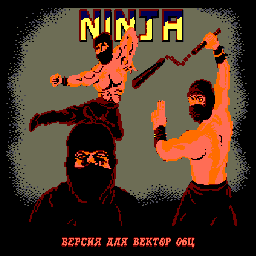
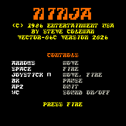
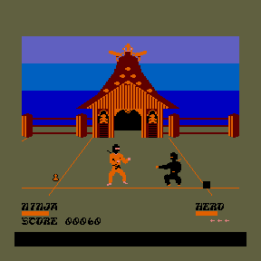
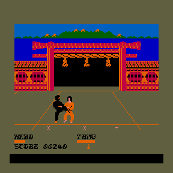
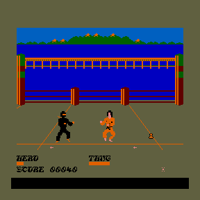
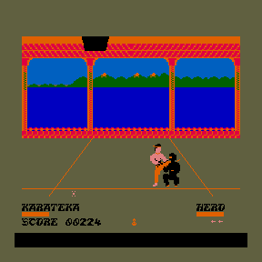

# Ninja — порт на Вектор-06Ц

**Ninja** (Mastertronic / Entertainment USA, 1986; автор — Steve Coleman, версия для ZX Spectrum — 1987) на
ванильном **Векторе-06Ц**: i8080 3 МГц, 64 КБ, без Z80-переходника и без квазидиска. За основу взята лента ZX
Spectrum, разобранная в SkoolKit (`src/ninja.ctl`). Логика переведена на i8080 через JS-модель и сверена с
оригиналом ZX проход в проход (12 сценариев, ~14 тысяч проходов главного цикла: тур по всем 21 комнате, бой,
идолы, смерть и GAME OVER, все способы управления, пауза) — и в отдельной сборке, и по экрану боевого образа.
Внешность — от версии **Amstrad CPC** (комнаты, палитры, кадры бойцов, шрифт) с несколькими деталями из
**Atari ST** (идол, продолжение перспективы пола, серые пол и HUD); музыка и звуки — от версии **Atari 8-bit**
(песня, подыгрывание, эффекты боя — на ВИ53 и спикере).

  

  

## Готовые образы

Образ памяти **с адреса 0x0000** (64 КБ): на MiSTer (ядро Vector-06C) открывается через меню ядра как `.C00`,
в эмуляторах (Emu80, vector06js) — как `.r0m`.

| Файл | Что это |
|---|---|
| [`rom/Ninja-v06c.c00`](rom/Ninja-v06c.c00), [`.r0m`](rom/Ninja-v06c.r0m) | заставка, стартовый экран с управлением, игра |

## Управление

Заставка — любая клавиша или огонь джойстика; стартовый экран — огонь (пробел).

| действие | клавиатура | джойстик «П» |
|---|---|---|
| ходьба, вверх (в дыру в потолке), вниз | ← → ↑ ↓ | влево, вправо, вверх, вниз |
| удар | пробел | огонь |
| пауза | ВК | |
| выход из игры | АР2 | |
| звук вкл/выкл | УС | |

Как в оригинале, удар выбирается направлением при нажатом огне (вперёд — куда смотрит герой): вверх — прыжок с
ударом, вниз — удар рукой снизу, вперёд — удар ногой в корпус, назад — бросок оружия (нож, сюрикен), вперёд-вверх —
высокий удар ногой, назад-вверх — меч, вперёд-вниз — низкий удар ногой.

## Что по-другому, чем на ZX

- **Цвет без клэша.** Комнаты, палитры и бойцы — как у CPC, цвет попиксельный; геометрия оригинала ×1,5
  (комната 40 тайлов по 6 точек).
- **Экран без тени.** Поле собирается по столбцам и пишется на экран один раз, перерисовываются только
  изменившиеся бойцы и оружие — без мерцания.
- **Звук Atari** — песня, пока в комнате нет врага, при враге — эффекты боя, тикание идола; шум — на спикере.
- **Исправлены ошибки оригинала**: враги в ближнем бою бьют героя (как у CPC), номер комнаты не портится,
  лежащее оружие не «качается» на полу.
- **HUD**: оружие в руках героя и собранные идолы — значками.
- **Заставка и стартовый экран** — показываются при включении, потом игра распаковывается (ZX0).

## Сборка

Нужны Node.js, Python 3 с Pillow и [SkoolKit](https://skoolkit.ca) 10.1 (`tools/.venv`),
[sjasmplus](https://github.com/z00m128/sjasmplus) (`tools/sjasmplus`) и лента ZX
`orig/emu-land-zip/Ninja (1987)(Entertainment USA).tap` (в репозиторий не входит; md5
`17f0119ddba03b41cb4095fbbdbd6342`, тот же файл — `NINJAMAD.TAP` на spectrumcomputing): из неё снимается образ
памяти игры. Графика CPC, песня Atari и шрифт уже лежат в `src/vec/gen/`; пересоздать их можно только из
материалов оригинала (`tools/mkcpc.py`, `tools/mksound.py`, `tools/mkfont.py`, `docs/ORIG.md`).

```sh
python3 -m venv tools/.venv && tools/.venv/bin/python -m pip install skoolkit==10.1 pillow
./build.sh          # build/vec/ninja.bin, rom/Ninja-v06c.r0m и .c00
./build.sh check    # и проверки: модель и i8080 по эталонам ZX, экран Вектора против экрана ZX
```

Для проверок нужен эмулятор [vector06js](https://github.com/svofski/vector06js) (по умолчанию
`~/projects/vector06js`, иначе путь в переменной `V06`).

Как устроено и проверено — [docs/PORT_PLAN.md](docs/PORT_PLAN.md), [docs/VECTOR.md](docs/VECTOR.md),
[docs/JOURNAL.md](docs/JOURNAL.md); разбор оригинала — [docs/MAIN_LOOP.md](docs/MAIN_LOOP.md),
[docs/DATA.md](docs/DATA.md), звук — [docs/MUSIC.md](docs/MUSIC.md).
